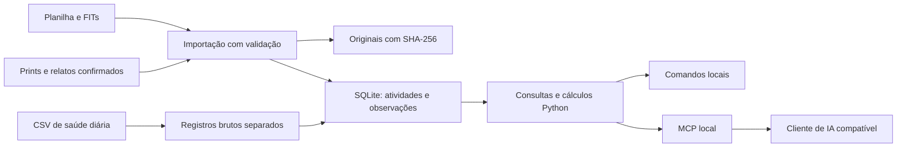

# Arquitetura e critérios

## Fluxo

Um único pacote Python contém os módulos. A importação, o histórico e os
cálculos funcionam sem um modelo de linguagem. O MCP expõe funções específicas
sem dar ao modelo acesso arbitrário ao sistema de arquivos ou execução de SQL.

## Módulos

| Módulo | Interface principal | Implementação que concentra |
|---|---|---|
| `readers` | `workbook`, `fit_file`, `csv_rows` | Formatos, unidades, CRC, datas e campos ausentes |
| `history` | `import_file`, `detail`, `list_activities` | Fontes, associação de treinos e prioridade por campo |
| `storage` | `Store`, `backup` | SQLite, transações e originais verificados |
| `analysis` | `period`, `weekly`, `compare`, `segment` | Critérios e cálculos reproduzíveis |
| `journal` | `propose_note`, `propose_plan`, `confirm` | Rascunhos, confirmação e versões |
| `cli`, `mcp_server` | Comandos e ferramentas | Conversão de entradas e apresentação dos resultados |

SQLite usa a biblioteca padrão, sem ORM nesta fase. Há apenas uma implementação
de armazenamento e nenhuma necessidade comprovada de abstrair vários bancos.
O SDK MCP já oferece HTTP local; FastAPI não é necessário para esta entrega.
PostgreSQL, autenticação remota e uma aplicação Android dependem de uma necessidade
de operação hospedada ou de uma fonte automática validada.

## Persistência e fontes

`sources` identifica o conteúdo por SHA-256 e preserva a cópia do arquivo.
`observations` guarda os valores de cada fonte, sem sobrescrever observações
anteriores. `activities` é o índice do treino; seus campos de busca são atualizados
pelas observações resolvidas. `samples` e `laps` preservam detalhes por fonte.
`source_rows` contém CSVs de saúde diária e esportes brutos. `profile_entries`
contém o contexto fornecido pelo usuário. Diário e planos são registros próprios.

Prioridades: FIT 100, transcrição de print 80, referência informada pelo usuário
75 e planilha 60. Um nome descritivo da planilha/print é preferido ao nome gerado
pelo FIT. Toda resposta detalhada contém a origem efetivamente usada por campo.
Prioridade é uma regra de seleção, não uma declaração de que uma fonte nunca erra.

A planilha perde arredondamentos que o FIT preserva: enriquecer a corrida de
31/10 altera a distância de 10,00 para 10,002 km e pode alterar os totais derivados.
Isso é esperado e rastreável. Valores de FC citados na descrição ficam separados
da FC média medida. Uma FC informada pelo usuário mantém essa origem identificada.

## Associação sem duplicar quilômetros

O mesmo conteúdo não é importado outra vez mesmo se renomeado. Entre fontes
diferentes, a associação exige modalidade e data iguais, duração com diferença
máxima de 3 segundos ou 1% e, quando disponíveis, distância com diferença máxima
de 30 metros ou 0,5% e início com diferença de até 120 segundos. Mais de um
candidato aborta a importação dessa fonte e pede um vínculo explícito de FIT.

Horas da planilha são locais com fuso ainda não confirmado. Horas FIT são UTC e
são convertidas usando `America/Sao_Paulo`. Não se adiciona sufixo UTC à hora
local da planilha. FIT multiesporte não é aceito para impedir mistura de amostras.
Treinos diferentes no mesmo dia e corridas encerradas/reiniciadas permanecem
separados, salvo evidência de que são a mesma atividade.

## Honestidade dos cálculos

- O período usa datas locais inclusivas e agrupa modalidades separadamente.
- Ritmo agregado depende de distância e tempo presentes no mesmo conjunto.
- Zero de elevação é preservado; ausência de FC não se torna zero.
- Média de FC da sessão, FC de volta, máxima e média aritmética das amostras têm
  nomes distintos. Cobertura em registros não significa cobertura em tempo.
- Trechos usam limites reais de distância, não extrapolação. Lacunas aparecem
  no resultado. Não se preenche FC faltante com registros diários.
- Candidatos à comparação usam modalidade, distância e duração; esforço,
  percurso, calor, fadiga e sensor continuam sendo fatores a verificar.
- Variação de ritmo ou volume nunca é convertida em perda de condicionamento,
  prazo de recuperação, VO2max ou zonas de FC.
- Potência de bike só aparece se o arquivo a fornecer; o sistema não estima FTP.

## Relatos e planos

Criar rascunho não altera o diário confirmado nem o plano. A confirmação exige
identificador e a frase `APROVAR`; é idempotente e cria uma nova versão de plano.
Os testes não são considerados relatos do atleta e usam bancos temporários.
Não há plano de treinamento aprovado automaticamente na base pessoal.

MCP é somente leitura por padrão. Escritas exigem opção de inicialização e
aprovação no cliente. A frase de confirmação não é autenticação de um usuário:
a interface precisa efetivamente colher essa autorização. O endpoint HTTP é
local e não substitui autenticação/OAuth para uma implantação remota.

## Limites desta entrega

- Transcrições dos seis prints foram feitas visualmente e confirmadas quando
  possível; o sistema não contém OCR automático.
- Os CSVs de sono têm linhas com colunas excedentes e datas estranhas. São
  preservados e sinalizados, sem correção por suposição ou uso em recuperação.
- Arquivos já importados são imutáveis. Uma correção deve ser uma nova fonte;
  resolver conflitos e desfazer vínculos ainda exige uma rotina futura.
- O arquivo de consolidação inicial precisa existir para `bootstrap` carregar
  os relatos e prints. Uma instalação nova deve receber esses arquivos pessoais.
- Não há integração com Strava, Zepp, Health Connect ou Intervals.icu nesta fase.
- A conexão no ChatGPT Plus não foi testada. O protocolo foi testado localmente.
- Os registros brutos são dados, não instruções. Descrições podem conter texto
  arbitrário e não devem orientar a execução de ferramentas.

## Fontes técnicas consultadas

- [SDK MCP Python](https://py.sdk.modelcontextprotocol.io/)
- [Ferramentas e anotações MCP](https://py.sdk.modelcontextprotocol.io/servers/tools/)
- [Saída estruturada](https://py.sdk.modelcontextprotocol.io/servers/structured-output/)
- [fitdecode](https://fitdecode.readthedocs.io/en/latest/)
- [SQLite: usos adequados](https://www.sqlite.org/whentouse.html)
- [MCP no Codex](https://learn.chatgpt.com/docs/extend/mcp?surface=app)
